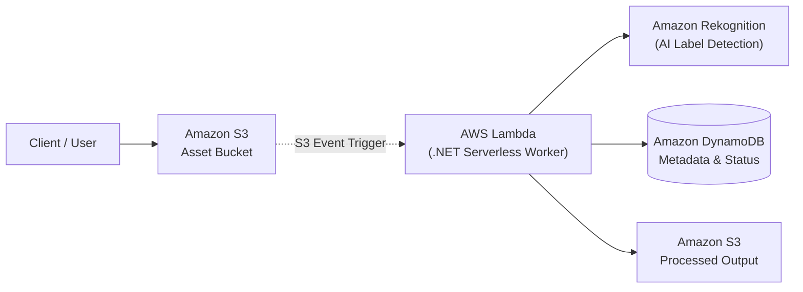

<div align="center">

# ☁️ Cloud Work

### Cloud-native architectures, AWS integration (Lambda, S3, DynamoDB), and serverless .NET / C# applications

[](https://github.com/akazad13/cloud-work/actions)
[](https://dotnet.microsoft.com/)
[](https://learn.microsoft.com/en-us/dotnet/csharp/)
[](https://aws.amazon.com/)
[](https://aws.amazon.com/lambda/)
[](https://aws.amazon.com/s3/)
[](https://aws.amazon.com/dynamodb/)
[](LICENSE)

[Overview](#-overview) •
[Architecture & Decisions](#-architecture--decision-records) •
[Testing Paradigm](#-testing-paradigm) •
[Projects Inventory](#-projects-inventory) •
[Tech Stack](#-tech-stack) •
[Quick Start](#-quick-start) •
[License](#-license)

</div>

---

## 📌 Overview

**Cloud Work** is a curated suite of practical cloud-native and serverless projects demonstrating how to build, integrate, and deploy scalable C# and .NET applications on Amazon Web Services (AWS). It covers object storage (S3), serverless compute (Lambda), NoSQL data persistence (DynamoDB), and event-driven image and video processing pipelines.

### Key Highlights
- ⚡ **Serverless Compute**: Event-driven AWS Lambda functions in .NET handling asset transformations and async workloads.
- 🗄️ **Object & Document Storage**: Integration with Amazon S3 bucket lifecycles and DynamoDB single-digit millisecond NoSQL access.
- 🖼️ **Media Pipelines**: Automated serverless image processing and GIF generation triggered directly by S3 upload events.
- 🏢 **Cloud Migration Blueprint**: Full-stack ASP.NET Core cloud portal (`TakeItToTheCloud`) structured for cloud deployment.

---

## 🏛 Architecture & Decision Records

The repository demonstrates a production-grade, event-driven cloud architecture built on AWS and .NET:



### Architectural Pillars
- ⚡ **Event-Driven Serverless Compute**: AWS Lambda functions triggered by S3 bucket events (`s3:ObjectCreated:*`) handle asynchronous media transformation, thumbnail generation, and GIF compilation without blocking client-facing request threads.
- 🗄️ **Dual-Store Persistence**: Binary assets are stored in Amazon S3, while structured item attributes, AI detection tags, and processing states are indexed in Amazon DynamoDB for single-digit millisecond query latency.
- 🖼️ **Cross-Platform Media Engine**: Image mutations are powered by `SixLabors.ImageSharp` 3.x, avoiding non-portable native GDI+ (`System.Drawing.Common`) dependencies to ensure flawless execution across Linux Lambda runtimes and containers.
- 🔒 **Secure Credential Resolution**: All services leverage the official AWS SDK for .NET v4 (`AWSSDK.S3`, `AWSSDK.DynamoDBv2`, `AWSSDK.Rekognition`, `AWSSDK.SQS`) configured through default credential provider chains (IAM roles, environment variables).

### Architecture Decision Records (ADRs)
Technical decisions, patterns, and trade-offs are documented as lightweight Architecture Decision Records in [`docs/adr/`](docs/adr/README.md):

| ADR | Title | Status | Area |
| :---: | :--- | :---: | :--- |
| **[ADR-0001](docs/adr/0001-record-architecture-decisions.md)** | [Record Architecture Decisions](docs/adr/0001-record-architecture-decisions.md) | `Accepted` | Governance & Standards |
| **[ADR-0002](docs/adr/0002-aws-serverless-architecture-and-dependency-modernization.md)** | [AWS Serverless Architecture and Dependency Modernization](docs/adr/0002-aws-serverless-architecture-and-dependency-modernization.md) | `Accepted` | Cloud Architecture & Dependencies |
| **[ADR-0003](docs/adr/0003-testing-paradigm-and-agentic-verification.md)** | [Testing Paradigm and Agentic Verification for Cloud & Serverless Solutions](docs/adr/0003-testing-paradigm-and-agentic-verification.md) | `Accepted` | Testing & QA |

For guidelines on authoring and updating ADRs, see the [ADR Index & Process Guide](docs/adr/README.md).

> [!NOTE]
> All projects utilize the official AWS SDK for .NET (`AWSSDK.S3`, `AWSSDK.DynamoDBv2`, `Amazon.Lambda.Core`).

---

## 🧪 Testing Paradigm & Agentic Verification

This repository codifies a cloud and serverless testing standard governed by [ADR-0003](docs/adr/0003-testing-paradigm-and-agentic-verification.md) and the `test-driven-development` engineering skill, optimized for both autonomous AI agents and human engineers:

- 🔒 **Zero Live Cloud Credentials**: All unit and component tests execute 100% locally and offline without requiring AWS accounts, IAM credentials, or STS tokens.
- 🧩 **In-Memory Cloud Test Doubles**: AWS service dependencies (`IAmazonS3`, `IAmazonDynamoDB`, `IAmazonRekognition`, `IAWSS3Helper`) are injected via constructor interfaces, enabling rapid in-process fakes.
- 📦 **Event-Driven Lambda Fixtures**: Serverless handlers are validated against deterministic, realistic S3 and API Gateway event fixtures (`S3Event`, `APIGatewayProxyRequest`, `EventNotification`).
- 🎯 **State Over Interaction Assertions**: Assertions verify resulting data state (image stream dimensions, DynamoDB document attributes, output models) rather than brittle SDK call counts.
- 📖 **DAMP Test Design**: Tests prioritize Descriptive And Meaningful Phrases and self-contained Arrange-Act-Assert flows for instant diagnostic clarity.
- 🔁 **Agentic TDD Loop**: Autonomous agents practice the Red-Green-Refactor loop with local `dotnet test` verification before committing code.

---

## 📂 Projects Inventory

| Project | Focus | Key Services |
| :--- | :--- | :--- |
| **`AWSS3Connect`** | Object storage operations: bucket lifecycle, file upload, download, and streaming | Amazon S3, .NET SDK |
| **`DynamoDBAndS3`** | Relational metadata storage paired with blob management | Amazon S3, DynamoDB |
| **`ServerlessAppForCreatingGIF`** | Event-driven Lambda function generating animated GIFs from uploaded media | AWS Lambda, Amazon S3 |
| **`ServerlessAppsForImgProcessing`** | Automated image transformation pipeline (resizing, optimization) on S3 triggers | AWS Lambda, Amazon S3 |
| **`ServerlessApplicationsWithAWS`** | Serverless REST API architectures and CloudWatch integration | API Gateway, Lambda |
| **`TakeItToTheCloud`** | Full-stack ASP.NET Core cloud portal ready for container and cloud hosting | ASP.NET Core, Bootstrap |

---

## 🛠 Tech Stack

| Domain | Technologies |
| :--- | :--- |
| **Language & Frameworks** | C#, .NET 8 / .NET Core, ASP.NET Core |
| **Cloud Provider** | Amazon Web Services (AWS) |
| **Compute & Serverless** | AWS Lambda, API Gateway |
| **Storage & Databases** | Amazon S3, Amazon DynamoDB |
| **SDKs & Libraries** | AWS SDK for .NET, AWSSDK.S3, AWSSDK.DynamoDBv2, Amazon.Lambda.Core |

---

## 🚀 Quick Start

### Prerequisites
- [.NET SDK](https://dotnet.microsoft.com/)
- [AWS CLI](https://aws.amazon.com/cli/) configured with valid credentials (`aws configure`)
- [Amazon.Lambda.Tools](https://github.com/aws/aws-extensions-for-dotnet-cli) (`dotnet tool install -g Amazon.Lambda.Tools`)

### 1. Clone & Browse Projects
```bash
git clone https://github.com/akazad13/cloud-work.git
cd cloud-work
```

### 2. Run Tests Locally
```bash
dotnet test
```

### 3. Run a Sample Web App
```bash
cd AWSS3Connect/AWSS3Connect
dotnet run
```

### 4. Deploy a Serverless Function
```bash
cd ../../ServerlessAppsForImgProcessing/ServerlessAppsForImgProcessing
dotnet lambda deploy-function ProcessImageFunction
```

---

## 🤖 AI-Driven Development & Contributing

Autonomous coding agents (Antigravity, Cursor, Claude Code, GitHub Copilot) operating in this repository must consult [AGENTS.md](AGENTS.md) for AWS credential safety rules (never commit access keys), solution structure, and build verification gates.

---

## 👤 Author

**Md. Abul Kalam**
- GitHub: [@akazad13](https://github.com/akazad13)
- LinkedIn: [Md. Abul Kalam](https://linkedin.com/in/akazad13)

---

## 📄 License

This project is licensed under the [MIT License](LICENSE).
